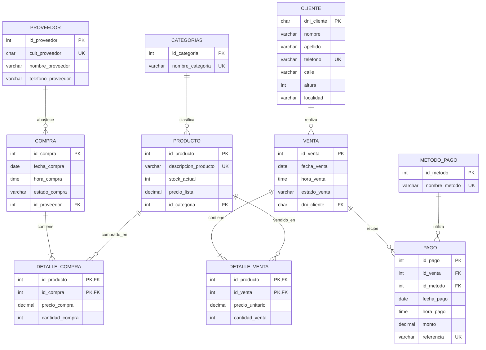

# Diagrama Entidad–Relación (DER)

El DER conceptual del proyecto fue elaborado por el equipo en **ERDPlus** utilizando notación **P. Chen**, según la consigna de Bases de Datos I.

## DER conceptual elaborado en ERDPlus

El diagrama original se conserva como evidencia histórica de la Etapa II y se muestra directamente desde el repositorio del equipo:

Fuente: `proyecto-bd1-equipo_30/docs/etapa-02/der/der-etapa02.png`.

## Control de consistencia con el modelo final

Durante el refinamiento e implementación se ajustaron nombres, tipos y algunas decisiones de integridad. El siguiente diagrama resume las relaciones del **modelo final vigente** y sirve como control visual frente a `modelo-relacional.md` y `sql/ddl/crear_bd.sql`.

La especificación formal de claves, restricciones y tipos se encuentra en `../modelo-relacional.md` y en `../../../sql/ddl/crear_bd.sql`.
